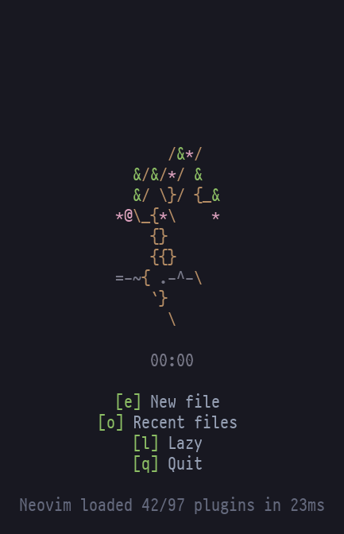

# sprout.nvim

Watch a tree grow in your editor. sprout.nvim gives your start screen an
ASCII bonsai that grows with the hour of the day.

<p align="center">
    
</p>

It's 8:30 A.M. You're getting a head start on a long day of writing TOML by hand.
You're greeted by a gentle sapling, just starting out its life.

It's 11:45 A.M. No strings have been parsed correctly in any bit of config
you've written. You're beginning to question what a string even is. But the
bonsai you see is strong. It's just begun to rise to meet the summer wind.

It's 7:52 P.M. Your phone has five missed calls from "Home" and your children's
names are a blur. Was this YAML the whole time? What does QWEN think? Your
bonsai has begun to droop and drop its leaves. Where did the time go?

It's 11:59 P.M. Chaos reigns. Single, double, even triple quotes dot the
pockmarked landscape of your buffers. Numbers are strings are blocks are files
are ... Your bonsai is dead. Just wood where life was. A cold draft sweeps
through and seems to turn the hands of the clock itself. 

12:00 A.M. A new day is here. You blink, rub, shake your head. The scales have fallen
from your eyes. The file parses clean, it was JSON all along! Ship it! Go Home!
Swim through the still blue midnight air to the warm embrace of _home_,
meatloaf still there in the microwave, _waiting_. Your bonsai is reborn. Just a
sprig now, but ready to grow strong while you sleep.


## Yeah but what is it?
It's a way to have an image grow over time in your dashboard. It handles picking
an image from a list of any length based on what time it is.

I wrote this description and the bonsai art and the original local version by
hand. I packaged it all up using Claude so others could use it.

## Usage

```lua
-- lazy.nvim
{  "zdcthomas/sprout.nvim", lazy = true }
```

Basic usage:
```lua
local header = require("sprout").pick()
```

`pick` returns the stage for the time of day as a multiline string. The
day is split evenly across the stages of the set, so a set can have any
number of stages. The bonsai set has seven stages, so each one lasts
about three and a half hours, and the dead tree shows from 20:35 until
midnight. Minutes and seconds count: a set with 48 stages moves to the
next stage every 30 minutes. To pick for another time, pass a whole or
fractional hour: `pick({ hour = 13.5 })` is 13:30.

`pick` returns `opts.default` (nil unless you set it) when the hour is
out of range or the set name is unknown. An unknown set name also warns
once through `vim.notify`.

### Dashboards

[mini.starter](https://github.com/echasnovski/mini.starter): pass a
function so the header re-evaluates on every open.

```lua
require("mini.starter").setup({
	header = function()
		return require("sprout").pick()
	end,
})
```

[dashboard-nvim](https://github.com/nvimdev/dashboard-nvim): the header
is a list of lines.

```lua
require("dashboard").setup({
	config = {
		header = vim.split(require("sprout").pick(), "\n"),
	},
})
```

## Art sets

Set a default set once:

```lua
require("sprout").setup({ set = "bonsai_boxed" })
```

Supply your own set with `register`. Stages are ordered youngest to
oldest:

```lua
require("sprout").register("cactus", {
	stages = { seed_art, sprout_art, full_art },
})

local header = require("sprout").pick({ set = "cactus" })
```

`pick` also accepts a set table directly: `pick({ set = { stages = {...} } })`.
The raw art is available in the `require("sprout").sets` registry, e.g.
`sets.bonsai.stages`. `pick({ boxed = true })` is an older shorthand for
`set = "bonsai_boxed"` and still works.

## Development

```sh
make test
```

The tests run in a clean Neovim and need nothing else installed.

`nix run` renders `assets/bonsai.gif` from the art in `lua/sprout/sets/`
with Iosevka. Set `SPROUT_FONT` to a font file path to use another font.
